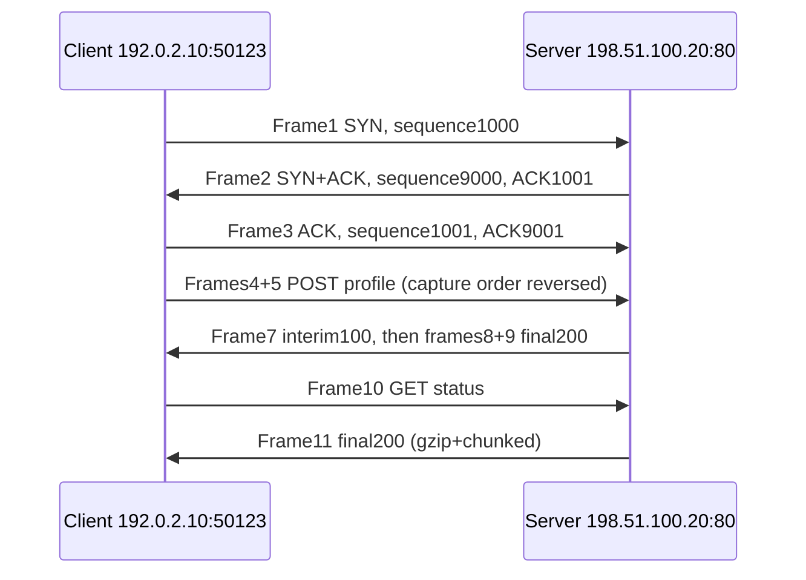
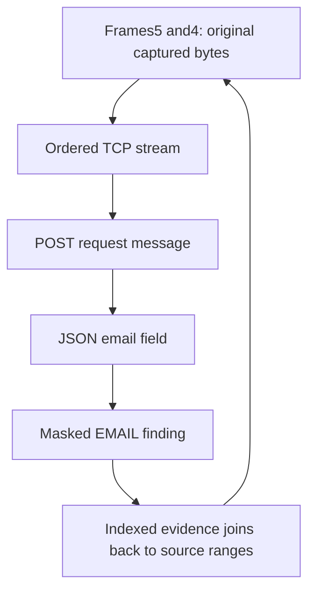

# Seven-slide outline and presenter script

Use the generated `mentor-demo.pcap`; all identities and endpoints are fictional.
This is a presentation outline with diagrams, not a rendered slide deck.

## Slide1 — What TRACE can show

**Visual:** Open the HTTP conversations tab alongside the EMAIL finding.

**Say:** “TRACE follows a recorded request and reply, then connects a possible
personal-data finding to the captured bytes supporting it. Missing or uncertain
evidence stays visible. This demonstration uses rules; model accuracy is a
separate question.”

## Slide2 — How a TCP conversation starts

**Say:** “The client asks to start; the server agrees and acknowledges; the client
acknowledges the server. An IP address identifies an endpoint on the network.
A port identifies the service or connection endpoint on that machine. The
client's50123 is temporary here. Port80 commonly carries plaintext HTTP;443
commonly carries HTTPS, but a port number alone does not prove the protocol.”

## Slide3 — Packets, flow, session, message, transaction

| Term | In this demo |
|---|---|
| Packet/frame | One captured unit, e.g.frame5 |
| TCP flow | Traffic grouped by transport endpoints |
| TCP session | One observed TCP connection; endpoint pairs can be reused later |
| Direction | Client→server or server→client; a capture may see only one |
| HTTP message | A request or response, often spread over packets |
| Transaction | Request plus observed associated responses; interim responses may precede final |
| Extracted field | Text value from headers, URL or supported body parsing |
| Finding | A rule match or model prediction against a field |

**Say:** “Here11 packets carry5 HTTP messages forming2 transactions. Nine
findings do not mean nine packets or nine people. One field can trigger more
than one detector.”

## Slide4 — Reassembly and original evidence

**Say:** “Frame4 arrived before5, but TCP sequence numbers give byte order.
Frame6 retransmits bytes; it is not another HTTP request. We verify the entire
capture hash and preserve source ranges. The email crosses two packets. The
independent reference reader recovers the same email from those bytes.”

## Slide5 — Known, transformed, missing

**Visual:** Compare the first request's email with the second response's
gzip/chunked JSON field.

**Say:** “Plain text can have exact whole-field source ranges. Compression or
escaped Unicode needs transformations: decoded character positions cannot be
called original packet-byte positions. A gap, truncation or conflicting overlap
can prevent reconstruction. Seeing no damage does not prove the capture is
complete. Seeing one direction does not justify inventing the other.”

## Slide6 — Safe response source and HTTPS boundary

**Visual:** Literal HTML source, including the inert script/image probes.

**Say:** “We can recover this captured response as source text when retention
and authorised reveal were enabled. TRACE does not execute its scripts or fetch
missing resources. That is not faithful recreation of an interactive webpage.
Ordinary HTTPS encrypts application content; this implementation does not
decrypt it. A future controlled test can export its own TLS secrets for
Wireshark, but that would not decrypt arbitrary third-party traffic.”

## Slide7 — What the numbers mean

| Dashboard quantity | Meaning / limitation |
|---|---|
| Captured packets | Records read from this file, including unsupported dispositions |
| TCP flows / HTTP messages / transactions | Reconstructed observations, not all traffic that ever existed |
| Extracted fields | Values produced by supported extraction |
| Rule findings | Pattern/key candidates; confidence is heuristic |
| ML evaluated / eligible / skipped | Coverage accounting under policy and explicit work limits |
| ML score | Uncalibrated model output;0.9 does not establish90% accuracy |
| Precision | TP/(TP+FP), requires independently labelled examples |
| Recall | TP/(TP+FN), also requires labels and honest missed-case accounting |
| F1 | Harmonic mean of precision/recall on the named labelled dataset |
| Synthetic probe F1 | Generated probe results, never uploaded-capture accuracy |

**Say:** “Rules and ML provide different evidence. Neither score verifies the
person's identity or that transmission was unauthorised. Accuracy requires
independent ground truth. The demonstration proves the implemented evidence
path on this fictional fixture; the remaining browser and Wireshark review
gates must be completed on the review machine.”
