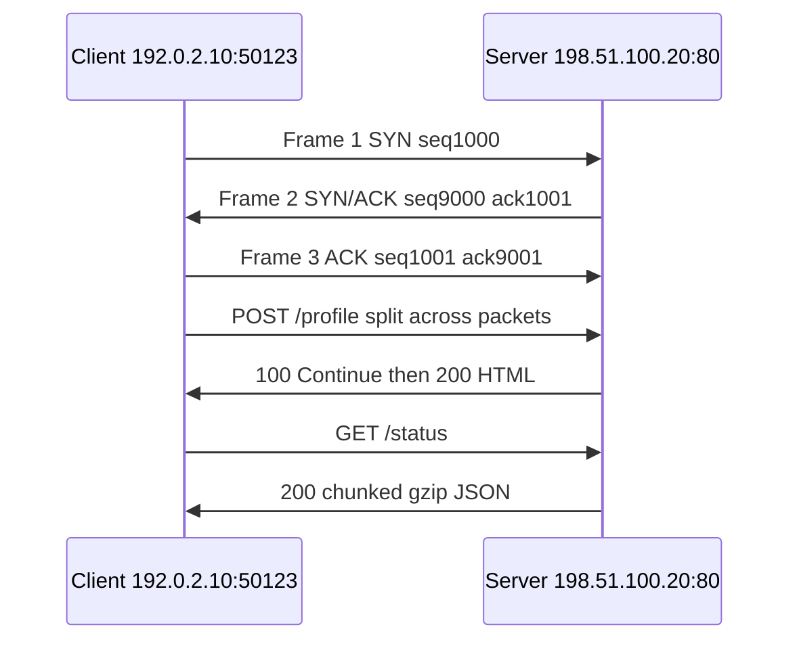
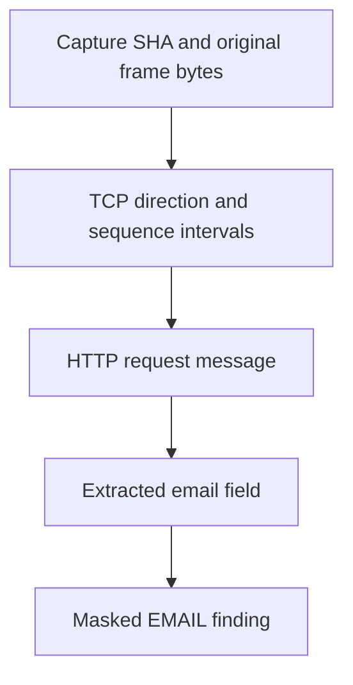

# TRACE — from captured packets to defensible evidence

Advay Katoch · Nishant review · 25 October 2026

**Demonstrated:** fictional PCAP → TCP → HTTP → recovered HTML → original bytes.
**Acceptance:** API + dpkt/h11 + TShark executed; genuine browser gate pending.

Presenter: “I will show what was captured, what was reconstructed, and which
original bytes support the finding. This fixture is not an accuracy benchmark.”

---

## 1. Establishing the connection

SYN consumes one sequence number. Wireshark may display relative0/1 values.
Both directions are captured; final connection completeness remains unknown.

Presenter: “Handshake dikha hai, lekin FIN nahi hai. Puri connection capture
hui bolna sahi nahi; supported HTTP messages complete mil sakte hain.”

---

## 2. Packets, streams and messages are different objects

| Object | Meaning | This fixture |
|---|---|---|
| Packet/frame | One captured network unit | 11 |
| TCP session/flow | Communication between endpoints | 1 |
| Directional stream | TCP payload ordered by sequence | 2 directions |
| HTTP message | Request, interim response or final response | 5 |
| Transaction | Best-effort request/final-response association | 2 |
| Finding | A flagged extracted candidate | 9 rule findings |

Frame4 arrives before5. Frame6 repeats5. Sequence positions determine byte
order; a repeated segment is not a new HTTP request.

Presenter: “Packet count aur finding count ko accuracy mat samajhna.”

---

## 3. What “HTTP page reconstructed” means here

| Capability | Delivered |
|---|---|
| HTTP conversation | Supported requests and responses reconstructed |
| Original HTML response source | Recovered from frames8/9; matches independent body SHA |
| Offline viewable representation | Captured text/allowed structure, explicitly lossy |
| Full original webpage | **Not claimed**: CSS, images, JavaScript and dynamic state absent |

Open `captured-response.html.txt`, then `captured-page.static.html`.
The malicious script/image probes in the source are omitted from the projection.
No missing resource is fetched. The source remains separately auditable.

Presenter: “HTML asli captured response se aaya hai. Static view uska safe subset
hai; original website ki full copy nahi.”

---

## 4. Show the PII candidate and its evidence chain

Client `192.0.2.10:50123` → server `198.51.100.20:80`, session1.
`flow_0001_direction_0` → `flow_0001_msg_0001` → field7 → EMAIL.
Capture SHA begins `fa0070187d39425f`; the full SHA is in EVIDENCE.md.

Presenter: “Finding sirf label nahi. Original packet tak connection dikha rahe
hain, aur captured file ka SHA verify kar rahe hain.”

---

## 5. Exact supporting original bytes

| Frame | Stream interval | File interval | Frame interval | Actual fictional text |
|---|---|---|---|---|
| 5 | [248,255) | [713,720) | [302,309) | `alex@ex` |
| 4 | [255,268) | [304,317) | [54,67) | `ample.invalid` |

Together: `alex@example.invalid`. TCP sequences: [1249,1256), [1256,1269).
All intervals are half-open; these offsets belong to this exact capture SHA.

dpkt/h11 and TShark independently checked the bytes. This is whole-field
support, not a fabricated detector-substring or Unicode-to-packet mapping.

Presenter: “Frame5 pehle reconstruct hua, chahe capture mein frame4 pehle aaya.”

---

## 6. Honest failure and transformation examples

- Remove original frame9: response gap detected; no complete200 invented.
- Remove handshake: SYN observation remains false; no inferred establishment.
- Chunked + gzip + JSON escaping: genuine compressed support, no one-to-one
  mapping from decoded Unicode positions to packet bytes.
- TLS, HTTP/3 and unsupported H2 source viewing remain outside this workflow.
- Authentication, explicit reveal acknowledgement, job expiry and masking apply.

Presenter: “Data absent ya encrypted ho toh uncertainty dikhana correctness
hai. Guess karke page complete nahi banate.”

---

## 7. Executed validation and remaining gate

**Executed:** authenticated upload/report/inspection/source APIs; complete and
incomplete fixtures; independent dpkt/h11; TShark4.2.2 with out-of-order
reassembly; targeted privacy, concurrency and provenance regression tests.

**Blocked:** Chrome crashed at startup in this environment. Run the provided Mac
browser script before claiming full UI acceptance. Genuine V2 weights were
absent; this demonstration is rules-only. No M3 performance claim is made.

One command: `bash scripts/validation/run_mentor_demo.sh --output demo-output`

Presenter: “Yeh actual engineering evidence hai. Browser aur model ke missing
checks ko passed nahi bola. Complete live presentation ke liye Mac browser gate
abhi karna hai.”
